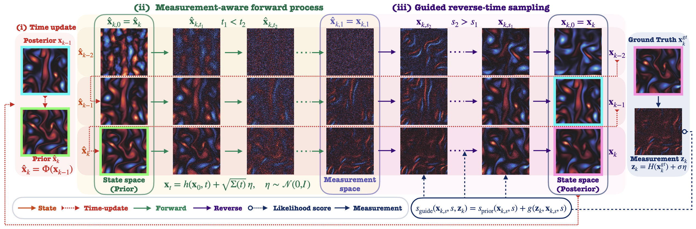
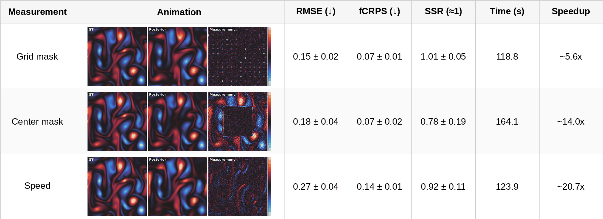
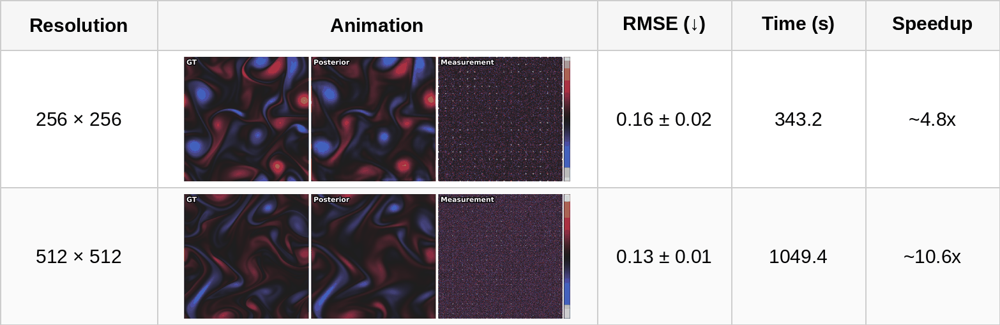
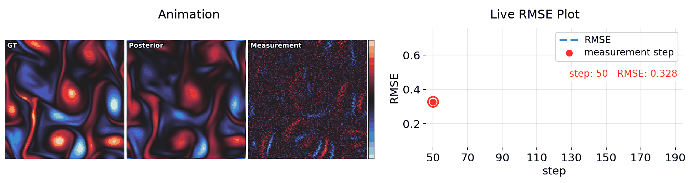

# MASF: Measurement-Aware Score-based Filter

[](https://arxiv.org/abs/2604.02889)

This repo contains the official implementation of **[Rethinking Forward Processes for Score-Based Nonlinear Data Assimilation in High Dimensions](https://arxiv.org/abs/2604.02889)**.

> The code and documentation are currently being organized and will be updated progressively.

## 0. Table of Contents

<details>
<summary><b>Contents</b></summary>
  
- [1. Overview](#1-overview)
- [2. Results](#2-results)
  - [2.1. Results at 128 × 128 Resolution](#21-results-at-128--128-resolution)
  - [2.2. High-Resolution Results with Grid Mask Measurements](#22-high-resolution-results-with-grid-mask-measurements)
  - [2.3. Temporal RMSE Evolution with Speed Measurement](#23-temporal-rmse-evolution-with-speed-measurement)
- [3. Code Implementation](#3-code-implementation)
  - [3.1. Code Structure](#31-code-structure)
  - [3.2. Installation](#32-installation)
  - [3.3. Single Experiment](#33-single-experiment)
- [4. Notebooks](#4-notebooks)

</details>

## 1. Overview

**MASF (Measurement-Aware Score-Based Filter)** is a score-based Bayesian filter for estimating the state of a nonlinear, high-dimensional dynamical system over time from model predictions and measurements.

Existing score-based filters adopt a classical forward process that transforms states toward a Gaussian distribution, independently of the measurement equation. As a result, the likelihood score at perturbed states must be approximated heuristically, and the resulting errors can accumulate over time under spatially sparse or nonlinear measurements.

MASF instead uses a **measurement-aware forward process** that interpolates states toward the measurement space according to the measurement equation. This gives a theoretically grounded likelihood score: exact for linear measurements and a principled approximation for nonlinear measurements. In the measurement-update step, guided reverse-time sampling transports samples from the measurement space back to the state space (figure below).

<p align="center">
  
</p>

### Key Features

- **Measurement-aware forward process**: interpolates between the state and measurement spaces according to the measurement equation, so the learned prior score reflects the state–measurement relationship.
- **Principled likelihood score**: exact for linear measurements and a theoretically grounded approximation for nonlinear measurements, derived via Markovian projection and, for linear measurements, a linear SDE with the same marginals as the forward process.
- **Accuracy and scalability**: improves accuracy on Lorenz96 and Kolmogorov flow, scaling to state dimensions on the order of `10^5` under nonlinear and dimensionally mismatched measurements.
- **Online efficiency**: amortized pretraining with a lightweight model gives up to a **20.7×** online wall-clock speedup over the baselines.

## 2. Results

We compare MASF with EnKF, LETKF, SF, and SSLS on two systems:

- **Lorenz96** (40 dimensions) with the monotonic cubic measurement `H(x)_i = x_i + 0.01 x_i^3`, a sanity check for nonlinear measurements.
- **Kolmogorov flow**, a two-dimensional incompressible flow governed by the forced Navier–Stokes equations (Re = 1000), at 128 × 128, 256 × 256, and 512 × 512 resolution, with the following measurements:

  - **Grid mask**: point-wise measurements on a regular grid (linear)
  - **Center mask**: measurements outside a central missing square (linear)
  - **Speed**: a nonlinear function of the squared local speed, repeated in both velocity channels (nonlinear, channel-coupled)

Performance is measured by RMSE, fair CRPS (fCRPS), and spread–skill ratio (SSR). The Kolmogorov flow tables below report MASF results (mean ± std over 5 seeds, 10 ensemble members); Speedup is the online wall-clock speedup over the slowest baseline.

### 2.1. Results at 128 × 128 Resolution

<p align="center">
  
</p>


### 2.2. High-Resolution Results with Grid Mask Measurements

<p align="center">
  
</p>

### 2.3. Temporal RMSE Evolution with Speed Measurement
<p align="center">
  
</p>


## 3. Code Implementation

### 3.1. Code Structure

```text
masf/
├── configs/                        # <dynamics>/<measurement>.yaml
├── dynamics/                       # Lorenz96, Kolmogorov flow
├── measurements/                   # Cubic, Grid mask, Center mask, Speed
├── methods/                        # MASF (linear / nonlinear measurements)
├── models/                         # UNet, dual-UNet, 1D UNet
├── notebooks/                      # Lorenz96 and Kolmogorov flow examples
├── main.py                         # Run a single experiment
├── utils/
├── README.md
└── requirements.txt
```

### 3.2. Installation

```bash
git clone https://github.com/tcnllab-oss/masf.git
cd masf
```

```bash
conda create -n masf python=3.10
conda activate masf
```

Install the requirements, which include the JAX GPU backend used by the Kolmogorov flow solver, and then PyTorch. The versions below are the ones used for the paper (CUDA 13.0). Install PyTorch last, because its cuDNN and NCCL libraries share a directory with the CUDA 12 libraries used by JAX.

```bash
pip install -r requirements.txt
pip install torch==2.12.1 torchvision==0.27.1 --index-url https://download.pytorch.org/whl/cu130
```

Download the pretrained checkpoints and pretraining data from Hugging Face. They are saved to `checkpoints/` and `datasets/`, matching the paths in the configs.

```bash
hf download eunbii1/masf --include "checkpoints/*" --local-dir .
hf download eunbii1/masf --repo-type dataset --include "datasets/*" --local-dir .
```

### 3.3. Single Experiment

Configs are grouped by dynamics: `configs/<dynamics>/<measurement>.yaml` (seed 42 by default).

```bash
python main.py -d kolmogorov_128 --measurement_type grid_mask --seed 42
```

| Dynamics (`-d`) | Measurements (`--measurement_type`) |
|---|---|
| `kolmogorov_128` | `grid_mask` (stride 10), `center_mask` (hole 0.5), `speed` |
| `kolmogorov_256` | `grid_mask` (stride 15) |
| `kolmogorov_512` | `grid_mask` (stride 20) |
| `lorenz96` | `cubic` |

Results are saved to `results/<dynamics>/<measurement>/seed<seed>/` (change with `--exp`). A custom yaml can be passed with `-c`.

## 4. Notebooks

| Notebook | Description |
|---|---|
| [`notebooks/lorenz96.ipynb`](notebooks/lorenz96.ipynb) | Lorenz96 with cubic measurements: pretrain from scratch and run filtering with online fine-tuning |
| [`notebooks/kolmogorov.ipynb`](notebooks/kolmogorov.ipynb) | Kolmogorov flow (128 × 128, grid mask): load the pretrained checkpoint and run filtering with online fine-tuning |
| [`notebooks/kolmogorov_center_mask.ipynb`](notebooks/kolmogorov_center_mask.ipynb) | Kolmogorov flow (128 × 128, center mask): load the pretrained checkpoint and run filtering with online fine-tuning |
| [`notebooks/kolmogorov_speed.ipynb`](notebooks/kolmogorov_speed.ipynb) | Kolmogorov flow (128 × 128, speed): load the pretrained checkpoint and run filtering with online fine-tuning |

The notebooks are saved with their outputs, so the result figures can be viewed without running them. Checkpoints and data are downloaded from Hugging Face ([model](https://huggingface.co/eunbii1/masf), [dataset](https://huggingface.co/datasets/eunbii1/masf)) inside the notebooks, and figures are saved to `notebooks/outputs/`. Install Jupyter with `pip install jupyter` to run them.
